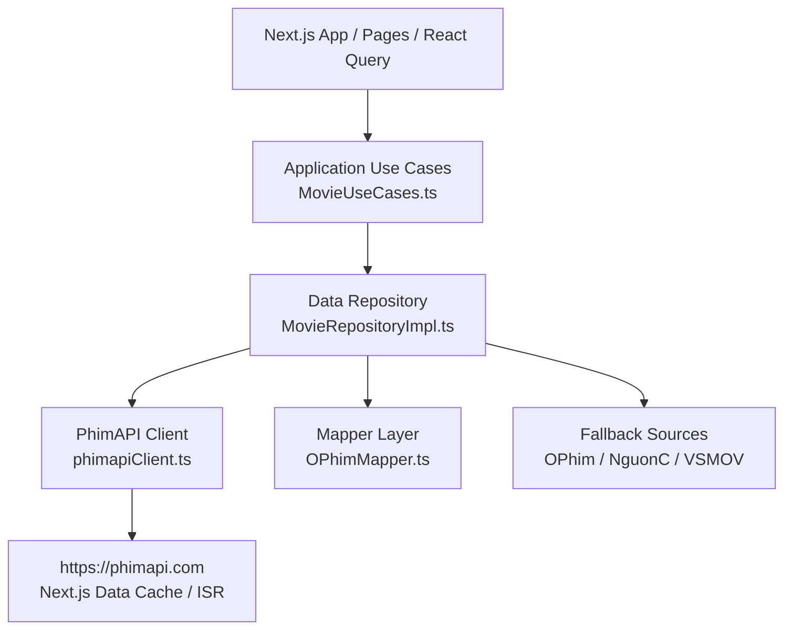

# 🎬 PhimAPI Integration & Architecture Documentation

Tài liệu chi tiết về việc tích hợp và gọi API từ **PhimAPI** (`https://phimapi.com`) trong hệ thống **Movie Web**. 
PhimAPI đóng vai trò là **Nguồn Dữ Liệu Chính (Primary Source)** của toàn bộ website cho danh sách phim, chi tiết phim, phân loại, tìm kiếm và link phát streaming (M3U8 / Embed).

---

## 📌 1. Tổng quan kiến trúc gọi API (Architecture Overview)

Luồng dữ liệu được thiết kế theo mô hình Clean Architecture (tách biệt rõ ràng Data Layer, Application Layer, và Presentation Layer):



### Các tầng xử lý chính:
1. **HTTP Client Helper (`src/data/api/phimapiClient.ts`)**:
   - Quản lý `BASE_URL = 'https://phimapi.com'`.
   - Sử dụng native `fetch` để tận dụng **Next.js Data Cache**.
   - Cấu hình tự động `AbortSignal.timeout(8000)` (8 giây) để tránh tắc nghẽn server.
   - Bắt lỗi an toàn, ghi warning log và trả về `null` thay vì văng exception làm crash giao diện SSR.

2. **Repository Layer (`src/data/repositories/MovieRepositoryImpl.ts`)**:
   - Hiện thực hóa `IMovieRepository`.
   - Định nghĩa mọi hàm truy xuất dữ liệu từ PhimAPI.
   - Điều phối cơ chế **Fallback 4 cấp** khi PhimAPI không có phim hoặc lỗi: `PhimAPI` ➔ `OPhim` ➔ `Nguồn C` ➔ `VSMOV`.

3. **Mapper Layer (`src/data/mappers/OPhimMapper.ts`)**:
   - Chuyển đổi dữ liệu JSON thô từ PhimAPI sang Domain Entity chuẩn (`Movie`, `MovieListResult`, `ServerData`, `Episode`).
   - Xử lý đường dẫn ảnh CDN (`phimimg.com/upload/vod` hoặc `phimimg.com/uploads/movies`).
   - Phân biệt ảnh poster dọc (`poster_url`) và ảnh thumb ngang (`thumb_url`).
   - Gắn nhãn nhận diện server: `(Nguồn Chính - PhimAPI)`.

4. **Application Layer (`src/application/useCases/MovieUseCases.ts`)**:
   - Điều phối gọi song song các danh mục trang chủ (`getHomeMovies`).
   - Xử lý tìm tập phát và link phát (`resolveStreamLink`).

5. **Presentation & Server Route (`src/app/`, `src/presentation/`)**:
   - SSR/SSG/ISR trên các trang: `/`, `/phim/[slug]`, `/xem-phim/[slug]/[episode]`, `/danh-sach/[type]`, `/the-loai/[slug]`, `/quoc-gia/[slug]`, `/nam-phat-hanh/[slug]`, `/tim-kiem`.
   - `/api/movies/[slug]/extra-sources`: Route nạp thêm các server phụ từ các nguồn khác song song trong lúc xem phim.

---

## 🔗 2. Bảng tổng hợp các Endpoint PhimAPI đang sử dụng

| STT | Chức năng | Phương thức & URL PhimAPI | File & Hàm trong Code | Cache / Revalidate |
| :--- | :--- | :--- | :--- | :--- |
| **1** | Phim mới cập nhật (Trang chủ) | `GET /v1/api/danh-sach/phim-moi?page={page}` | `MovieRepositoryImpl.getNewlyUpdated` | 300s (5 phút) |
| **2** | Danh sách phim lẻ | `GET /v1/api/danh-sach/phim-le?page={page}` | `MovieRepositoryImpl.getSingleMovies` | 300s (5 phút) |
| **3** | Danh sách phim bộ | `GET /v1/api/danh-sach/phim-bo?page={page}` | `MovieRepositoryImpl.getSeriesMovies` | 300s (5 phút) |
| **4** | Danh sách phim hoạt hình | `GET /v1/api/danh-sach/hoat-hinh?page={page}` | `MovieRepositoryImpl.getAnimatedMovies` | 300s (5 phút) |
| **5** | Danh sách TV Shows | `GET /v1/api/danh-sach/tv-shows?page={page}` | `MovieRepositoryImpl.getTvShows` | 300s (5 phút) |
| **6** | Danh sách phim chiếu rạp | `GET /v1/api/danh-sach/phim-chieu-rap?page={page}` | `MovieRepositoryImpl.getCinemaMovies` | 300s (5 phút) |
| **7** | Chi tiết phim & danh sách tập | `GET /phim/{slug}` | `MovieRepositoryImpl.fetchPhimAPIDetail` | 60s (1 phút) |
| **8** | Tìm kiếm phim theo từ khóa | `GET /v1/api/tim-kiem?keyword={kw}&limit=24&page={p}` | `MovieRepositoryImpl.searchMovies` | `no-store` (Tức thì) |
| **9** | Lọc theo thể loại | `GET /v1/api/the-loai/{slug}?page={p}&category=...` | `MovieRepositoryImpl.getMoviesByCategory` | 300s (5 phút) |
| **10** | Lọc theo quốc gia | `GET /v1/api/quoc-gia/{slug}?page={p}&...` | `MovieRepositoryImpl.getMoviesByCountry` | 300s (5 phút) |
| **11** | Lọc theo năm phát hành | `GET /v1/api/nam-phat-hanh/{year}?page={p}&...` | `MovieRepositoryImpl.getMoviesByYear` | 300s (5 phút) |
| **12** | Lọc theo danh sách chung | `GET /v1/api/danh-sach/{slug}?page={p}&...` | `MovieRepositoryImpl.getMoviesByList` | 300s (5 phút) |
| **13** | Lấy danh mục tất cả thể loại | `GET /v1/api/the-loai` | `MovieRepositoryImpl.getCategoryList` | 300s (5 phút) |
| **14** | Lấy danh mục tất cả quốc gia | `GET /v1/api/quoc-gia` | `MovieRepositoryImpl.getCountryList` | 300s (5 phút) |

---

## 📦 3. Chi tiết từng luồng gọi & Cấu trúc dữ liệu

### 3.1. Chi tiết phim và Link phát trực tuyến (`GET /phim/{slug}`)
Đây là endpoint quan trọng nhất, cung cấp toàn bộ thông tin metadata, đánh giá TMDB / IMDb và các server phát trực tuyến.

* **URL thực tế**: `https://phimapi.com/phim/{slug}`
* **Revalidate**: 60 giây (đảm bảo khi phim có tập mới thì người dùng thấy ngay).
* **Cấu trúc JSON gốc trả về**:
```json
{
  "status": true,
  "msg": "",
  "movie": {
    "_id": "6b1e39cd98683276de7b96e9454a6eca",
    "name": "Matlock (Phần 2)",
    "slug": "matlock-phan-2",
    "origin_name": "Matlock (Season 2)",
    "content": "<p>Nội dung giới thiệu phim...</p>",
    "type": "series",
    "status": "completed",
    "thumb_url": "https://phimimg.com/uploads/movies/20261012/matlock-phan-2-thumb.webp",
    "poster_url": "https://phimimg.com/uploads/movies/20261012/matlock-phan-2-poster.webp",
    "trailer_url": "https://www.youtube.com/watch?v=...",
    "time": "42 phút/tập",
    "episode_current": "Hoàn Tất (16/16)",
    "episode_total": "16",
    "quality": "FHD",
    "lang": "Vietsub",
    "year": 2026,
    "actor": ["Kathy Bates", "Skye P. Marshall"],
    "director": ["Kat Coiro"],
    "category": [
      { "id": "37a7b38b6184a5ebd3c43015aa20709d", "name": "Chính Kịch", "slug": "chinh-kich" }
    ],
    "country": [
      { "id": "74d9fa92f4dea9ecea8fc2233dc7921a", "name": "Âu Mỹ", "slug": "au-my" }
    ],
    "tmdb": {
      "type": "tv",
      "id": "226174",
      "season": 2,
      "vote_average": 7,
      "vote_count": 157
    },
    "imdb": {
      "id": "tt26591147",
      "vote_average": 7.5,
      "vote_count": 17569
    }
  },
  "episodes": [
    {
      "server_name": "Vietsub",
      "server_data": [
        {
          "name": "Tập 01",
          "slug": "tap-01",
          "filename": "Matlock (Phần 2) - Tập 01",
          "link_embed": "https://player.phimapi.com/player/?url=https://a.kvp726.com/20261011/PopEJ348/index.m3u8",
          "link_m3u8": "https://a.kvp726.com/20261011/PopEJ348/index.m3u8"
        }
      ]
    }
  ]
}
```

* **Xử lý trong Movie Web**:
  - `mapMovieDetail()` ánh xạ thành entity `Movie`.
  - Server name được format lại thành: `"Vietsub (Nguồn Chính - PhimAPI)"`.
  - Video player ưu tiên chạy trực tiếp `link_m3u8` (HLS stream) trên Video.js / ArtPlayer / native mobile ExoPlayer; nếu trình duyệt không hỗ trợ mới fallback sang `link_embed` iframe.

---

### 3.2. Danh sách phim theo danh mục (`GET /v1/api/danh-sach/{type}`)
Dùng để hiển thị các hàng phim ở trang chủ và phân trang ở trang danh sách (`/danh-sach/[type]`).

* **URL thực tế**:
  - `https://phimapi.com/v1/api/danh-sach/phim-moi?page=1`
  - `https://phimapi.com/v1/api/danh-sach/phim-le?page=1`
  - `https://phimapi.com/v1/api/danh-sach/phim-bo?page=1`
  - `https://phimapi.com/v1/api/danh-sach/hoat-hinh?page=1`
  - `https://phimapi.com/v1/api/danh-sach/tv-shows?page=1`
  - `https://phimapi.com/v1/api/danh-sach/phim-chieu-rap?page=1`
* **Cấu trúc JSON gốc trả về**:
```json
{
  "status": "success",
  "data": {
    "APP_DOMAIN_CDN_IMAGE": "https://phimimg.com",
    "items": [
      {
        "_id": "6b1e39cd98683276de7b96e9454a6eca",
        "name": "Matlock (Phần 2)",
        "slug": "matlock-phan-2",
        "origin_name": "Matlock (Season 2)",
        "thumb_url": "uploads/movies/20261012/matlock-phan-2-thumb.webp",
        "poster_url": "uploads/movies/20261012/matlock-phan-2-poster.webp",
        "type": "series",
        "year": 2026,
        "time": "42 phút/tập",
        "episode_current": "Hoàn Tất (16/16)",
        "quality": "FHD",
        "lang": "Vietsub",
        "category": [...],
        "country": [...],
        "tmdb": { "vote_average": 7, "id": "226174", "type": "tv" },
        "imdb": { "vote_average": 7.5, "id": "tt26591147" }
      }
    ],
    "params": {
      "pagination": {
        "totalItems": 30330,
        "totalItemsPerPage": 24,
        "currentPage": 1,
        "totalPages": 1264
      }
    }
  }
}
```

* **Xử lý ảnh CDN (`resolveImageUrl`)**:
  - Đối với PhimAPI:
    - Poster dọc: `posterUrl` = `APP_DOMAIN_CDN_IMAGE + "/upload/vod/" + item.poster_url` (hoặc link trực tiếp nếu đã có domain).
    - Thumbnail ngang: `thumbUrl` = `APP_DOMAIN_CDN_IMAGE + "/upload/vod/" + item.thumb_url`.
  - Hàm `mapMovieFromList()` tự động sửa lỗi trùng lặp đường dẫn `/upload/vod/` hoặc `/uploads/movies/`.

---

### 3.3. Tìm kiếm phim (`GET /v1/api/tim-kiem`)
Dùng khi người dùng gõ từ khóa tìm kiếm trên thanh search hoặc trang `/tim-kiem`.

* **URL thực tế**: `https://phimapi.com/v1/api/tim-kiem?keyword={keyword}&limit=24&page={page}`
* **Cấu hình Cache**: `{ cache: 'no-store' }` (không lưu cache để kết quả tìm kiếm luôn mới nhất và phản hồi ngay lập tức theo từ khóa).
* **Đặc tính**:
  - Hỗ trợ phân trang qua `page` và số lượng phim mỗi trang qua `limit=24`.
  - Trang `/tim-kiem` chia tab đa nguồn: tab mặc định là **"Nguồn Chính (PhimAPI)"**, cùng các tab chuyển đổi sang **OPhim**, **Nguồn C**, và **VSMOV**.

---

### 3.4. Lọc phim nâng cao (Thể loại, Quốc gia, Năm phát hành)
Hỗ trợ lọc kết hợp nhiều điều kiện thông qua hàm `buildFilterUrl`:
- Thể loại: `/v1/api/the-loai/{categorySlug}?page={page}&country={country}&year={year}`
- Quốc gia: `/v1/api/quoc-gia/{countrySlug}?page={page}&category={category}&year={year}`
- Năm phát hành: `/v1/api/nam-phat-hanh/{year}?page={page}&category={category}&country={country}`
- Danh mục tĩnh: `/v1/api/the-loai` (26 thể loại) và `/v1/api/quoc-gia` (36 quốc gia) được tải về để làm dropdown bộ lọc. Có mảng fallback cứng dự phòng nếu API gặp sự cố mạng.

---

## 🛡️ 4. Cơ chế Dự phòng & Khả năng Chịu lỗi (Resilience & Fallback)

### 4.1. Khởi tạo `phimapiFetch` an toàn
```typescript
export async function phimapiFetch<T = unknown>(
  path: string,
  revalidate: number = 300
): Promise<T | null> {
  const url = `${BASE_URL}${path}`;
  try {
    const res = await fetch(url, {
      next: { revalidate },
      headers: { accept: 'application/json' },
      signal: AbortSignal.timeout(8000), // Timeout 8s
    });

    if (!res.ok) {
      console.warn(`[PhimAPI Warning] ${res.status} ${res.statusText} — ${url}`);
      return null;
    }
    return (await res.json()) as T;
  } catch (e) {
    console.warn(`[PhimAPI Exception] — ${url}`, e);
    return null;
  }
}
```

### 4.2. Fallback chi tiết phim đa tầng (Multi-tier Detail Fallback)
Khi truy cập trang phim theo slug (ví dụ `/phim/dai-hiep-hoang-phi-hong`):
1. Hệ thống ưu tiên gọi PhimAPI: `fetchPhimAPIDetail(slug)`.
2. Nếu PhimAPI trả về lỗi hoặc không tồn tại (`status === false` / `404`):
   - Tự động gọi sang `fetchOPhimDetail(slug)`.
   - Nếu vẫn không có: gọi sang `fetchNguonCDetail(slug)`.
   - Nếu vẫn không có: gọi sang `fetchVsmovDetail(slug)`.
3. Nhờ cơ chế này, website gần như không bao giờ bị trang trắng (404) nếu phim có mặt ở bất kỳ nguồn nào trong 4 nguồn.

### 4.3. Nạp nguồn phát phụ song song (`/api/movies/[slug]/extra-sources`)
Khi người dùng vào xem phim (`/xem-phim/[slug]/[episode]`):
- Trang web render trước với các server của PhimAPI.
- Đồng thời ở phía Client, hook `useExtraSources` gọi ngầm về route nội bộ `/api/movies/[slug]/extra-sources`.
- Server Next.js gọi song song `OPhim`, `Nguồn C`, `VSMOV` qua `Promise.allSettled()`, trích xuất link `.m3u8` và bổ sung thêm các server phụ vào danh sách server của trình phát.
- Nếu server PhimAPI quá tải hoặc chết link, người dùng chỉ cần click đổi server sang nguồn phụ để xem tiếp mà không bị gián đoạn.

---

## 📝 5. Tóm tắt các điểm cần lưu ý khi phát triển
1. **Domain hình ảnh**:
   - PhimAPI sử dụng domain CDN ảnh là `https://phimimg.com`.
   - Khi hiển thị danh sách thẻ phim (`MovieCard`), `posterUrl` là ảnh dọc (chuẩn tỷ lệ 2:3) và `thumbUrl` là ảnh ngang (chuẩn tỷ lệ 16:9).
2. **Episode Slug & Tập phim**:
   - Định dạng slug tập phim của PhimAPI thường là `tap-1`, `tap-01`, `tap-full`.
   - Hàm `isEpisodeMatch` và `resolveStreamLink` trong `MovieUseCases.ts` đã được chuẩn hóa để đối chiếu linh hoạt theo cả số thứ tự (`1` khớp với `tap-01` hoặc `Tập 1`).
3. **Đồng bộ Lịch sử xem (Watch History)**:
   - Dữ liệu lịch sử xem phim liên kết với PhimAPI bằng trường `source: 'phimapi'` và `slug` gốc của phim.
